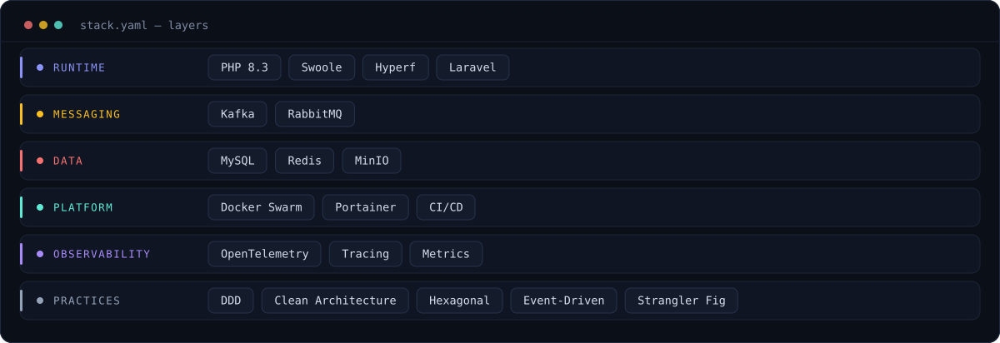

  

### `$ whoami`

Senior Software Engineer and Tech Manager in Belo Horizonte, Brazil. I design and build **high-performance PHP systems**: microservices, messaging, performance and observability, in systems that have to keep running while they change.

Today I own the architecture and lead the engineering team of a SaaS platform serving around 3,000 business customers in production.

### `$ git log --oneline --highlights`

| Area | What I did |
|:--|:--|
| **Core service rewrite** | Rebuilt a business-critical service from scratch on **Hyperf**, with DDD and Clean Architecture |
| **Legacy modernization** | Incremental migration off a legacy codebase with the **Strangler Fig** pattern, zero downtime |
| **Observability** | Led the **OpenTelemetry** rollout across a distributed platform |
| **Delivery & quality** | Built CI/CD, automated test pipelines and **Docker Swarm** staging environments |

### `$ cat stack.yaml`

  

### `$ now`

- Running event-driven flows on **Kafka** in production
- Postgraduate studies in Software Architecture at Full Cycle (2025 – 2027)

---

  <a href="https://www.linkedin.com/in/pedrohlbarros">LinkedIn</a> ·
  <a href="https://github.com/pedrohlbarros?tab=repositories">Repositories</a>

